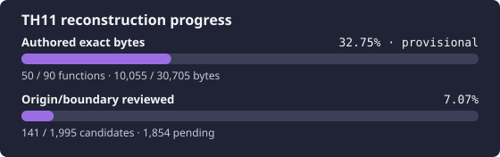

# 東方地霊殿 ～ Subterranean Animism

<p align="center">
  
</p>

This project reconstructs the original Japanese TH11 version 1.00a executable.
It follows the [TH10 reconstruction](https://github.com/N0zoM1z0/th10) workflow:
target identity, reviewed boundaries and origins, maintained source, exact
historical code generation, native product closure, and runtime validation are
tracked separately.

## Exact target

Supply your own copy at the ignored path `resources/th11.exe`.

| Property | Required value |
| --- | --- |
| Version | original Japanese 1.00a |
| Size | `688,128` bytes |
| SHA-256 | `2978b17f6184d100d249d4311348dd30c5c32ec75c014b667a525b797d3d8813` |
| MD5 | `6af1e3b37f28293f4fc127ee01d2632c` |
| Image base | `0x00400000` |
| Entry point | `0x00461B1D` |

The pinned [thcrap version database](https://github.com/thpatch/thcrap-tsa/blob/f08b582ce57bce800955dd371fc9a68dbad5b324/base_tsa/versions.js)
identifies this exact SHA-256 as `th11`, `v1.00a`, `(original)`.
The localized `th11c.exe` is a different target.

```bash
scripts/repo-python scripts/verify-target.py
scripts/repo-python scripts/validate-tracking.py --require-target
scripts/repo-python scripts/report-reconstruction-status.py
```

Original executables, game data, Ghidra databases, decompiler output, compiler
payloads, and generated build artifacts are private and never committed.

## Current status

The initial direct-Ghidra inventory contains 1,988 provisional function
candidates. See generated [`docs/PROGRESS.md`](docs/PROGRESS.md) for current
review, source, and exact counts; unresolved gaps can change the inventory.
Canonical units include bounded angle arithmetic, 32-key repeat/edge state,
the complete keyboard polling path, individual joystick-button capture, draw
callback dispatch/removal, file existence checking, and the ASCII update
callback. Update dispatch, ordered callback registration, gameplay joystick
merging, and paired byte transforms remain maintained non-exact candidates.
The Windows i386 production build is open. Semantic reconstruction and
portability have not started.

TH11's PE linker version is **9.0** and its dominant Rich compiler build is
**21022**. The compiler candidate is **VC9 / Visual C++ 2008 RTM**, selected
from TH11-local evidence. TH10's VC7.1 compiler is not used. Tool hashes and
independent normal C/C++, `/GL`, resource, linker, and PDB smoke checks are
tracked in [`config/tools.lock.toml`](config/tools.lock.toml).

```bash
scripts/repo-python scripts/verify-toolchain.py --execute
scripts/repo-python scripts/build-match-unit.py --check
scripts/repo-python scripts/replay-exact-units.py --unit poll-joystick-buttons
scripts/repo-python scripts/progress.py
scripts/repo-python scripts/ci.py
```

Canonical normal-COFF units cold-compile maintained C/C++ with the locked VC9
compiler. The Oracle requires a complete compiler-owned function extent and
exhaustive declared relocations, replays their target bindings, and compares
every byte. Artifact receipts bind source inputs, profile, target, tools, and
object hashes. Masked probes do not grant exact credit. Public primary-TU
linked contributions use a separate [VC9 linked Oracle](docs/LINKED_ORACLE.md),
with complete PE/MAP/PDB identity, ownership, artifact receipts and exhaustive
field replay. Specialized static/EH/split-owner contexts remain open.

## Tools and resource limits

Use `scripts/repo-python` for the pinned Capstone interpreter. Direct Ghidra
headless scripts verify the selected tool hashes, executable identity, mapped
samples, and the complete mapped `.text` hash before queries. REA is not used.
The private database is `ghidra-project/TH11`.

Ghidra runs at nice 10 with one CPU affinity, one analysis worker, and a 768 MiB
Java heap limit. JVM and native overhead are additional. Ghidra jobs and
Wine/compiler jobs are serialized. Tool installation and reproduction details
are in [`docs/TOOLS.md`](docs/TOOLS.md).

## Required phase order

1. Review boundaries/origins and reconstruct exact historical-toolchain units.
2. Close and exercise the faithful Windows i386 product, including data,
   initializers, resources, libraries, translation units, and link order.
3. Reconstruct semantics with the original and reconstructed native products as
   independent runtime Oracles.
4. Begin portability after the native baseline is trustworthy.

## Project map

- [`AGENTS.md`](AGENTS.md) — session recovery and evidence rules.
- [`config/target.toml`](config/target.toml) — TH11 identity, PE, and Rich facts.
- [`config/build.toml`](config/build.toml) — explicitly open production graph.
- [`config/match-units.toml`](config/match-units.toml) — canonical exact contexts.
- [`docs/RE_WORKFLOW.md`](docs/RE_WORKFLOW.md) — reconstruction loop and gates.
- [`docs/ORACLES.md`](docs/ORACLES.md) — bounded acceptance rules.
- [`docs/RE_HANDOFF.md`](docs/RE_HANDOFF.md) — resume state and next work.
- [`docs/KNOWLEDGE_BASE.md`](docs/KNOWLEDGE_BASE.md) — durable TH11-local facts.

## License

Repository-authored code and documentation are provided under the MIT License.
This does not grant rights to the original game or its assets. Infrastructure
adapted from TH10 retains its MIT license and attribution.
